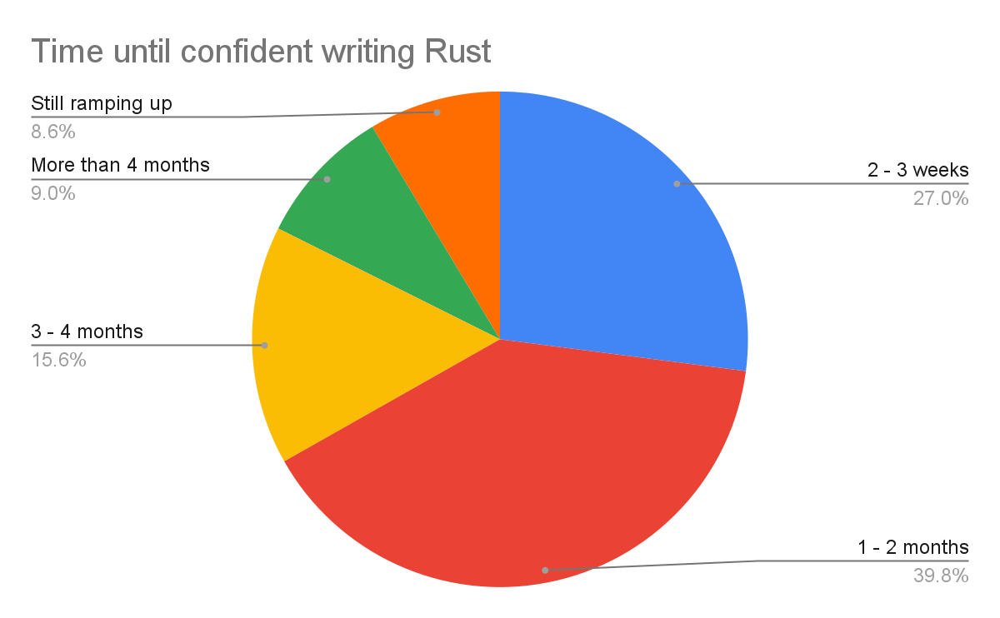

+++
title = "Why OTTO Chose Rust"
date = 2026-11-18
draft = false
template = "article.html"
[extra]
series = "Rust Insights"

resources = [
    "[OTTO's Rust migration: Lambdas and microservices](https://www.otto.de/jobs/en/blogs/techblog/rust-migration-lambdas-microservices/): the original OTTO tech blog post",
    "[We Have Named Arguments at Home](/blog/named-arguments-at-home/): avoiding mistakes with interchangeable function arguments",
    "[Bugs Rust Won't Catch](/blog/bugs-rust-wont-catch/): where Rust's safety guarantees end",
    "[Flattening Rust's Learning Curve](/blog/flattening-rusts-learning-curve/): practical approaches to learning Rust",
]
+++

<link rel="stylesheet" href="quotes.css">


I recently had the pleasure of interviewing [Falk Woldmann Lu](https://www.linkedin.com/in/falk-woldmann/) about [OTTO's recent migration](https://www.otto.de/jobs/en/blogs/techblog/rust-migration-lambdas-microservices/) of TypeScript Lambdas and Kotlin/Spring services to Rust.

For readers outside Germany: OTTO is one of the country's largest online retailers, with [around 13 million active customers and €7.5 billion in gross merchandise value in the 2025/26 financial year](https://www.otto.de/unternehmen/ueber-uns/).

Falk is a Senior Fullstack Developer at OTTO and an Adjunct Rust Tutor at NORDAKADEMIE.

## Why Rust?

**Q: What was the recurring annoyance that made you start looking into Rust?**

We used to write our AWS Lambda functions in TypeScript (around 2022), and a couple of things bugged us about it. First, the build process was annoying because you had to bundle external dependencies. If you just bundled your whole `node_modules` directory, you also shipped build-time dependencies like `esbuild` or test runners. We used the `serverless` framework, but had to drop it at some point when they switched to a commercial license.

Next, the churn in TS/JS tooling got on our nerves. It felt like we had to switch to the newest hot tool every two weeks or so, and nothing ever worked out of the box.

The last thing was the language itself. TypeScript only gives you type safety at build time, so you have to be really careful about parsing data at runtime. Just casting your deserialized data with `as Foo` obviously isn't enough, and we shot ourselves in the foot with that a couple of times. On top of that, the ecosystem was still pretty fractured between ESM and CommonJS back then, which caused even more headaches until everything ran smoothly.

---

**Q: But why Rust? You had plenty of less adventurous choices available like Kotlin or Go.**

Kotlin was the obvious candidate. We knew it well and it's a good language, but most of our pain was around it. We actually tried running Kotlin on Lambda, and the tooling was about as painful as with TypeScript. Getting thin JARs to build was a struggle, and Spring Cloud Function was too buggy to rely on. Our Spring Boot services gave us their own headaches too, more on that later. Some of that is on Spring and not on Kotlin. In practice, though, Kotlin on the backend means the JVM and usually Spring.

With Rust we kept the expressiveness and got a few things on top. Errors are values you have to handle, data is immutable by default, ownership is explicit, and resource usage is predictable because there's no garbage collector. We could also use one language for Lambdas and long-running services. **In the end, Rust fixed both problems we actually had: the painful Lambda tooling and the unpredictable runtime behavior.**

**Q: If an experienced Go team had been sitting in your chairs, do you think they could reasonably have made the opposite decision?**

It really depends on what you focus on. At OTTO we mostly do brownfield product development, so for us it's all about longevity. Go chose to keep the language small so you can ship fast. But most language complexity exists for a reason, and languages like Rust, Kotlin or Swift let us express more of our logic in code. That matters a lot to us, because we care about stability and predictability over many years.

---

<figure style="margin: 2em 0;">
  
  <figcaption>
    <p><a href="https://woldmann.com/">Falk Woldmann Lu</a> specializes in Rust, distributed systems, cloud infrastructure, and DevOps. He's also a co-maintainer of <a href="https://github.com/httpmock/httpmock">httpmock</a>, the HTTP mocking library mentioned in this interview.</p>
    <p>Photo: <a href="https://www.otto.de/jobs/en/blogs/techblog/authors/falk/">OTTO tech blog</a>.</p>
  </figcaption>
</figure>

## The First Production Services

**Q: Take us back to the first Rust service you actually deployed. What were you nervous about and what happened once it went live?**

Rolling out our first Rust Lambda was exciting, since it was the first real test of our idea.

The deployment itself was pretty unspectacular, though, because we started with a small internal Lambda. We could confirm right away that the Rust Lambda tooling works really well in production. Our hunch also held up: Lambdas are so high-level that a Rust Lambda doesn't feel very different from a TypeScript one. The syntax is different, sure, but you get used to it quickly, and most of Rust's more complex concepts like lifetime management just don't come up.

After those good experiences we migrated all our Lambdas. Execution time (warm and cold) and resource usage both went down a lot. That wasn't a big deal for us, since our Lambdas weren't particularly time-critical or expensive.

Our first "real" web service in Rust was a different story. There's a lot more to think about, like routing, scaling behavior and resource usage, so we were a lot more nervous. When we got our first `Hello World` back from the prototype, we were pretty ecstatic 😄

**What helped with the actual migration was starting small.** We took one piece of logic out of our big presentation service and rebuilt it in Rust. We had wanted to pull that logic out anyway, since it had little to do with presenting benefits, so it was a good candidate. The smaller scope kept the risk low and made it much easier to figure out how to set up a Rust web app properly.

**Q: Was there one graph, metric, or moment where the team thought: "Okay, this is cool"?**

That moment came when the service went live. The performance difference was massive. **Our P99 roughly halved and resource usage dropped to a quarter**, and that was with our first, pretty naive implementation. After a quick look at the code we removed an expensive clone on the hot path, which cut RAM usage in half again. That was great to watch and a really nice confirmation for us.

<blockquote class="otto-pullquote">
  <p>“Our first Rust code was pretty much Spring with Rust syntax.”</p>
</blockquote>

## Learning to Write Rust

**Q: You’ve said that some of your first Rust code was essentially Java or Spring thinking translated into Rust. What did you have to unlearn before you started writing Rust that actually felt like Rust?**

Controllers, services and repositories, all as structs, with dependency injection rebuilt on top. At first we used traits as the abstraction so we could swap in test implementations. We dropped that quickly, because generics and trait bounds for static dispatch spread through every signature and the code got really hard to read. We moved to [faux](https://github.com/nrxus/faux), which can mock concrete structs without traits. That felt very familiar, basically Mockito for Rust.

That layering is still there today, but we're moving more and more towards *[Functional Core, Imperative Shell](https://www.destroyallsoftware.com/screencasts/catalog/functional-core-imperative-shell)*. Business logic goes into pure functions without side effects, which you can test without any mocks, and the I/O lives around them. So we need far fewer mocks now. What's left we cover with integration tests against real components, like a containerized database or a real HTTP server via [httpmock](https://github.com/httpmock/httpmock). Those give us a lot more confidence than a pile of mocks.

The second big shift was actually using the type system: newtypes, ["Parse, don't validate"](https://lexi-lambda.github.io/blog/2019/11/05/parse-don-t-validate/), enums for domain states, and [typestate](https://cliffle.com/blog/rust-typestate/) where it pays off. We studied this together with NORDAKADEMIE in a [paper](https://dl.acm.org/doi/10.1145/3830438.3830958), using exactly this production code.

My favorite example is the *Dreson*. At OTTO that's a small grammar for describing a set of products. Our tag handler renders the little badges like "-20%" on product tiles, and it receives two Dresons per request: the context a benefit was configured for, and the context the customer is looking at right now. In the original code, both were plain strings. The validation was copy-pasted inline in the handler, couldn't be tested on its own, and other handlers couldn't reuse it. Worst of all, a validated Dreson was still just a `String` afterwards. Nothing told you whether it had been checked, so code that skipped validation or ran it three times compiled just fine.

For the paper, we refactored it into a newtype:

```rust
pub(super) struct Dreson(String);

impl Dreson {
    pub fn from_string(dreson: String, exceptions: &[String]) -> anyhow::Result<Self> {
        if is_valid(&dreson) || exceptions.contains(&dreson) {
            Ok(Dreson(dreson))
        } else {
            Err(anyhow::anyhow!("Invalid dreson format"))
        }
    }
}
```

It lives in its own private module, so the constructor is the only way to get one. Any function that takes a `Dreson` can trust the value is valid, and the signature tells you that without reading any docs. The validation is reusable and easy to test. In the refactoring, the handler's cognitive complexity went from 17 to 8, and the runtime cost was too small to matter. **For me, newtypes have the best cost/benefit ratio of any Rust pattern.** The catch is that you have to use them consistently. As soon as someone goes back to the inner string, that code loses the guarantee. **So we parse as early as we can, ideally right at the system boundary.**

I'm more careful with typestate. In the paper we also modeled the flow of our Detailview service as a state machine, so the steps can't be called in the wrong order anymore. Testability and correctness got a lot better, and the cyclomatic complexity of the main function dropped from 17 to 3. You pay for that with boilerplate, though, and even our experts disagreed on whether it's more readable. Typestate pays off most with lots of branching and lots of invariants. For a linear flow it's often overkill.

**Q: What’s your favorite example of fighting the borrow checker only to finally realize that the compiler had exposed a problem in your design?**

Almost all our fights with the borrow checker happened when our code wasn't very rusty, mostly early on. Lots of mutable state, lots of imperative code, data passed around and changed along the way. The fix was rarely a clever lifetime annotation. Usually we had to restructure how data flowed, and looking back, the compiler was right almost every time.

One of our Lambdas for product returns is a good example of how we used to write code. It had two mutable lists for results and errors, and every function got them as `&mut` and modified them. That worked, but it was hard to tell what state the program was in at any point, and testing it was a pain. When we refactored it for the paper, the results and errors moved into the states themselves and each step became a pure function. Now that we write more idiomatic code, the borrow checker rarely gets in our way. Those fights were mostly a sign that our design was off.

<blockquote class="otto-pullquote">
  <p>“Rust made us better developers, and I notice that in other languages too.”</p>
</blockquote>

---

## Bringing the Team Along

**Q: What changed once the entire team had to work in Rust?**

The biggest help was learning Rust as a team. For the basics we used the usual resources: [the Rust Book](https://doc.rust-lang.org/book/), [Rustlings](https://rustlings.rust-lang.org/) and [100 Exercises to Learn Rust](https://rust-exercises.com/100-exercises/). **What made the difference was applying it to production code right away, with small, self-contained changes while pairing.** At first the compiler feels like one more opponent. Once someone sits next to you and explains why it's complaining, it turns into a safety net pretty quickly.

We also ran a format we called "Rust Watch and Learn", which had two parts. In the first, people from the team showed something they had recently learned or built in Rust. In the second, we discussed a blog post or video everyone had read or watched beforehand, very often one of [Jon Gjengset's](https://www.youtube.com/@jonhoo). Since everyone came prepared, the discussion got into the details fast. Jon's videos work really well for this because he explains why things are built the way they are.



Hear more from Jon in our [Helsing episode of Rust in Production](/podcast/s06e02-helsing/), where he talks about building safety-critical software in Rust.

<div><script id="letscast-player-8654cc1e" src="https://letscast.fm/podcasts/rust-in-production-82281512/episodes/helsing-with-jon-gjengset/player.js?size=s"></script></div>



How fast were people productive? A lot faster than Rust's reputation suggests. That lines up with [Google's numbers from 2022](https://opensource.googleblog.com/2023/06/rust-fact-vs-fiction-5-insights-from-googles-rust-journey-2022.html). More than two-thirds of respondents felt confident contributing to a Rust codebase within two months, and within four months more than half were as productive as in their previous language. Google found no evidence of a productivity penalty for Rust among the developers surveyed. It also helps that we mostly write fairly high-level CRUD code, which rarely touches the hard parts of Rust.

<figure style="margin: 2em 0;">
  
  <figcaption>Time until confident writing Rust. Source: <a href="https://opensource.googleblog.com/2023/06/rust-fact-vs-fiction-5-insights-from-googles-rust-journey-2022.html">Google's 2022 Rust survey</a>.</figcaption>
</figure>

**Q: Was there anyone on the team who initially disliked Rust and later changed their mind?**

There was skepticism in the team and also from managers and other stakeholders, which is fair. We were pitching a language that was pretty unusual for our kind of backend at the time. **Two things won people over. The team actually learned Rust, and the learning curve turned out to be much less scary than expected.** And the results were better: fewer bugs, better performance, lower costs.

My favorite example is a colleague who was the loudest critic at the start. Today he's one of our biggest Rust evangelists 😄

---

## Reliability and Its Limits

**Q: What kinds of failures disappeared after the migration, and how much of that do you really attribute to Rust rather than to rewriting the system more carefully?**

The unpredictable runtime behavior is gone. In our old Kotlin/Spring services we kept seeing weird memory behavior, sometimes leaks, sometimes out-of-memory errors. We had to restart one service every day just to free up memory. The other big category was context and bean exceptions on startup. Those showed up a lot, even after minor Spring Boot updates, often because some starter pulled in something we had never configured ourselves. Spring is huge, it has grown over many years, and a lot of it is a black box. We were done with those surprises.

We count anything that has a negative impact on customers as an incident. On the system level, meaning a service crashing, leaking memory, slowing down or failing to start, we haven't had a single one since the migration. With Kotlin we had those quite a lot: after Spring Boot updates, from memory leaks, from bad performance. The services run very reliably now, memory usage is flat and predictable, and nobody has to restart services daily anymore. Logic bugs are a different story; I'll get to those in a second.

How much of that is Rust and how much is the careful rewrite? Both, to be fair. Some of it simply comes from dropping Spring. But the Rust ecosystem works very differently. There's no auto-configuration and nothing magic happening at runtime. You build your service from small pieces you picked yourself, and if something isn't in the code, it doesn't happen. There's also no garbage collector to tune, and errors show up in the types, so you have to handle them. Sure, we cleaned up a lot during the rewrite, but Rust pushed us towards those decisions.

<blockquote class="otto-pullquote">
  <p>“Rust is boring, and that's fantastic.”</p>
</blockquote>

**Q: And the important counter-question: what kinds of bugs does Rust do absolutely nothing to protect you from?**

Logic bugs, of course. We once showed the wrong headline on a customer benefit tile. The headline depends on whether you're a guest, logged in, or also a member of OTTO Up, our loyalty program. Everything compiled, all the types lined up, and the customer still saw the wrong text.

Here's a simplified version I made up for this (our real code looks different), just to show how something like that can happen:

```rust
fn headline(is_logged_in: bool, is_up_member: bool) -> &'static str {
    match (is_logged_in, is_up_member) {
        (true, true) => "Your Up benefit",
        (true, false) => "Join Up and save",
        (false, _) => "Log in to claim your benefit",
    }
}

// Compiles just fine, but the arguments are swapped.
let text = headline(customer.is_up_member, customer.is_logged_in);
```

That's perfectly valid Rust. Two `bool`s are interchangeable as far as the compiler cares, and the match is even exhaustive. This is where I think we could get more out of Rust. If you model the customer status as an enum, a whole class of mistakes goes away:

```rust
enum CustomerStatus {
    Guest,
    LoggedIn,
    UpMember,
}

fn headline(status: &CustomerStatus) -> &'static str {
    match status {
        CustomerStatus::Guest => "Log in to claim your benefit",
        CustomerStatus::LoggedIn => "Join Up and save",
        CustomerStatus::UpMember => "Your Up benefit",
    }
}
```

Now there's nothing to swap, and every status has exactly one headline. If someone adds a new status later, the compiler points you to every match that needs updating. What Rust can't catch is me putting the Up member text in the `LoggedIn` arm. That compiles just as well. Only a human knows what the headline should say, so we still need tests. With typestate you could go even further. We're not there yet, we're still learning to use Rust to its full extent. Compared to Kotlin or TypeScript, Rust gives me better tools to rule out these mistakes step by step, and when I refactor, the compiler walks me through every place that's affected.

---

## What Got Harder

**Q: In your blog post, you’ve spent a lot of time talking about what improved. So make the case against your own decision: what became harder, slower, more annoying, or simply less pleasant after moving to Rust?**

What I miss most is mocking from the JVM world. With [Mockito](https://site.mockito.org/) or [MockK](https://mockk.io/) you can mock pretty much anything in Kotlin and it just works. The JVM can generate bytecode at runtime. Rust has no reflection like that, so mocking concrete types relies on macros that rewrite your code at compile time. We use faux for that and it's fine most of the time. You do notice the magic, though. It all happens at compile time, so it has never bitten us in production, but you feel it in the editor. In RustRover, autocompletion on mocked structs sometimes suggested the wrong things because the IDE got confused by the rewritten code. And some structures just don't work. We [ran into](https://github.com/nrxus/faux/issues/66) a case where a newtype around a mocked struct stopped compiling in tests, because faux needs all fields to be private. The maintainer says that's by design. Fair enough, but it means the mocking tool decides how you structure your code. Mocking in Kotlin feels a lot more mature and stable.

The funny thing is that this pushed us in a good direction. Because mocking in Rust hurts, we leaned even harder into the functional core and the integration tests I talked about earlier.

**Q: A bit of a loaded question, but what’s something that takes 30 lines in Rust that you still occasionally wish were five lines of Kotlin?**

With MockK, stubbing a dependency is a single line. With faux in Rust, it often means more setup, or restructuring your code so it can be mocked at all.

---

## When Not to Rewrite

**Q: Imagine another team at OTTO comes to you and says: “We saw what you did. We want to migrate our backend to Rust too.” What would you ask them before saying yes?**

That actually happened. My first question is always: what problems do you have with your current stack? Rust is very trendy right now, but **FOMO is a bad reason to migrate.** If a team is happy with Kotlin and Spring, their services run fine and nothing really hurts, a rewrite mostly means risk and effort. We had concrete problems, like painful tooling for our Lambdas and Spring behaving unpredictably at runtime. We picked Rust because it solved those.

That said, I've become a lot more bullish on Rust as a default lately. For our kind of backend I see Rust clearly ahead of Java, Kotlin and Go, because none of them gives you an expressive type system, errors as values and no garbage collector all at once. And one of the big arguments against Rust, [the learning curve](/blog/flattening-rusts-learning-curve/), matters less every month. With agentic workflows you write fewer lines yourself. I'd even say Rust is one of the best languages for agents. The type system and the very descriptive compiler errors give an agent fast and precise feedback. It changes something, the compiler says exactly what's wrong, it fixes it. Agents love that loop. What's good for devs turns out to be good for agents too 😉

---

## A Few Less Serious Questions

All right. Short answers now.

**Q: Rust feature you initially hated but now love?**

[`macro_rules!`](https://doc.rust-lang.org/reference/macros-by-example.html). It was very confusing at first, but once you grok the syntax, it lets you get rid of a lot of boilerplate. For instance, we use it to generate lots of _newtype_ structs.

**Q: Rust feature you still hate? 😉**

[`Pin`](https://doc.rust-lang.org/std/pin/struct.Pin.html). I know there are good reasons for it to exist, but as a lowly app developer, every time I see it pop up somewhere, I know I'm in trouble 😆

**Q: One thing Java or Kotlin still does better than Rust?**

The Kafka ecosystem is a lot more mature in the JVM world. In Rust, [`rdkafka`](https://github.com/fede1024/rust-rdkafka) is pretty much the only viable option, and it's just a wrapper around the native C library. That causes some issues with compile times and cross-compilation.

**Q: Most underrated crate?**

[typify](https://github.com/oxidecomputer/typify) and [compio](https://github.com/compio-rs/compio)

**Q: How many crab-related items are currently visible in your office?**

We obviously have a crab plushie. It was actually caught attacking the mascot of our sister team, which builds a lot of OTTO-internal JVM tooling. Their mascot is a symbol for that.


**That was fun! Thanks for the interview, Falk.**



Thinking about introducing Rust into your backend? We help teams assess where Rust makes sense and migrate incrementally, without rewriting everything at once. [Learn about our Rust consulting services](/services/).

