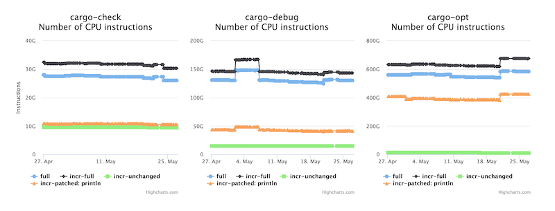
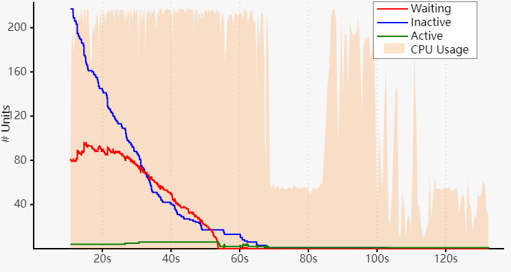
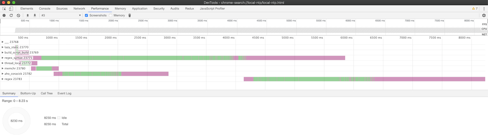
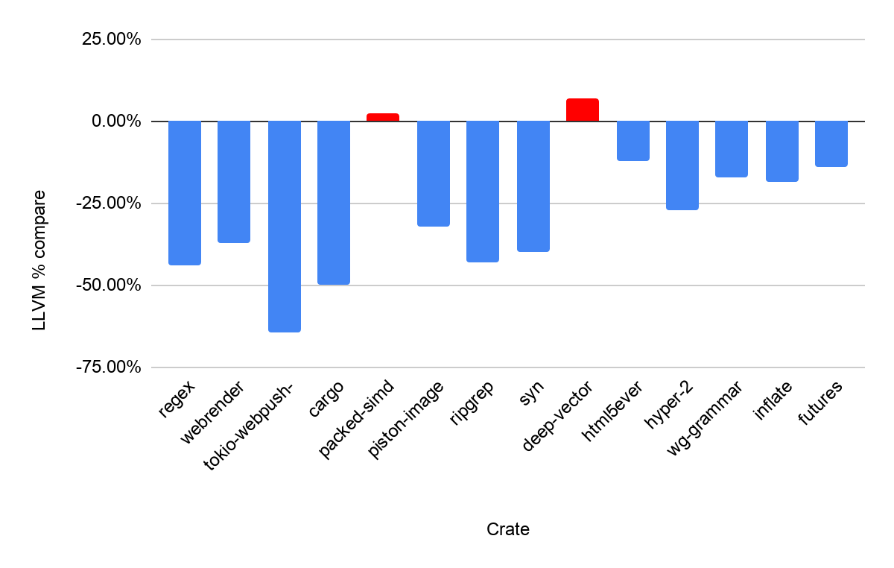
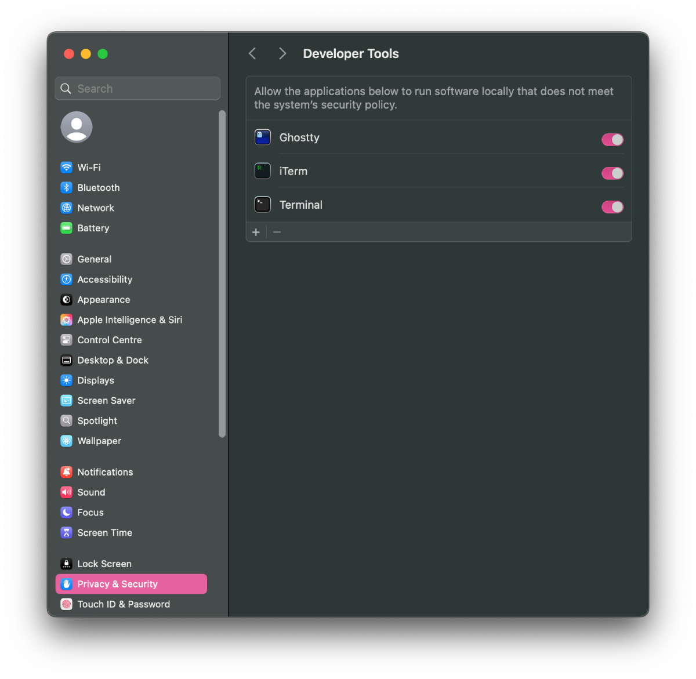
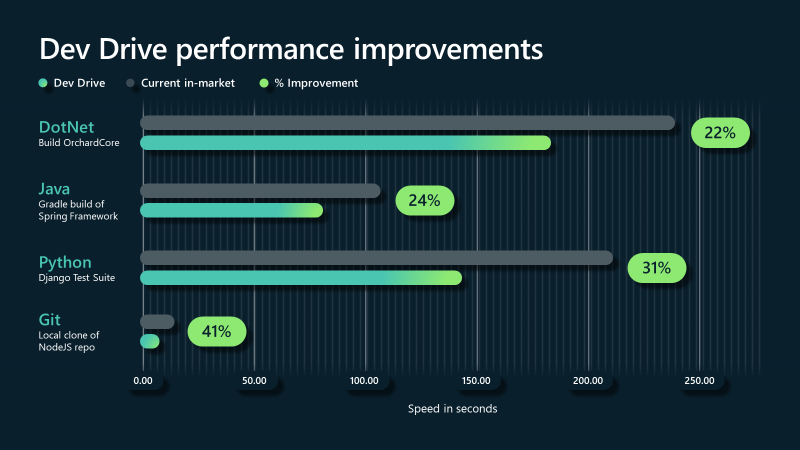
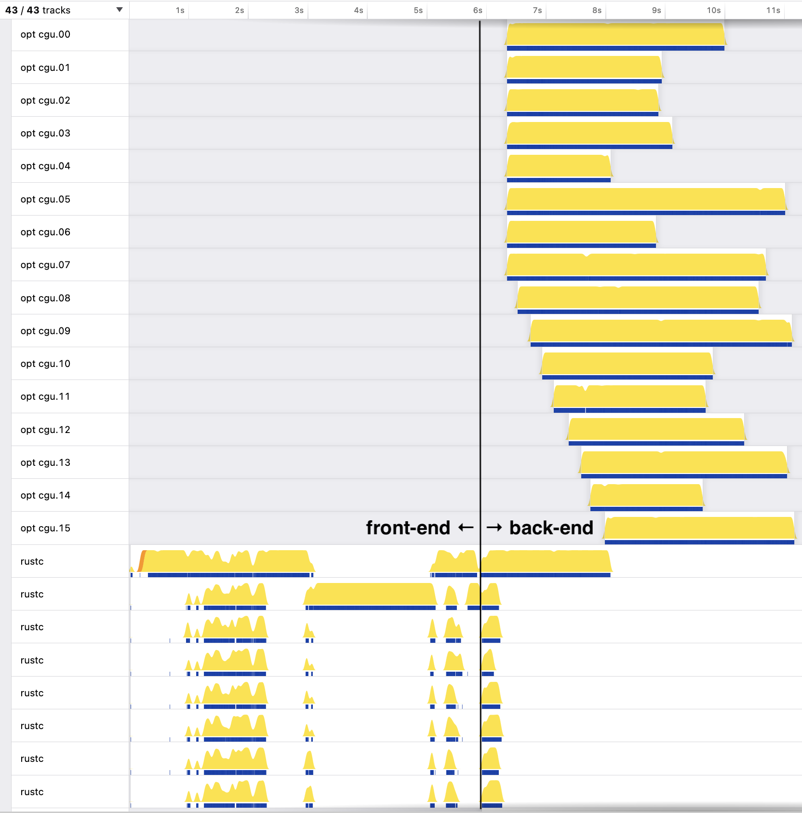

+++
title = "Tips For Faster Rust Compile Times"
date = 2024-01-12
updated = 2026-11-17
draft = false
template = "article.html"
[extra]
series = "Rust Insights"
resources = [
 "[Tips for faster CI builds](/blog/tips-for-faster-ci-builds/) - My collection of tips to speed up your CI builds.",
 "[The Rust Perf Book](https://nnethercote.github.io/perf-book/compile-times.html) has a section on compile times.",
 "List of [articles on performance on Read Rust](https://readrust.net/performance).",
 "[8 Solutions for Troubleshooting Your Rust Build Times](https://medium.com/@jondot/8-steps-for-troubleshooting-your-rust-build-times-2ffc965fd13e) is a great article by Dotan Nahum that I fully agree with.",
 "Improving the build times of a bigger Rust project (lemmy) [by 30%](https://lemmy.ml/post/50089).",
 "[arewefastyet](http://web.archive.org/web/20210510182416/https://arewefastyet.rs/) (offline) measures how long the Rust compiler takes to compile common Rust programs.",
 "[Speeding up the Rust edit-build-run cycle ](https://davidlattimore.github.io/posts/2024/02/04/speeding-up-the-rust-edit-build-run-cycle.html): A benchmark-driven approach to improving Rust compile times.",
]
reviews = [ 
    { name = "Nicholas Nethercote", url = "https://nnethercote.github.io/" },
    { name = "Ishan Bhanuka", url = "https://github.com/twitu" },
]
+++

**Slow Rust Builds?**

Here are some tips to speed up your compile times.
This list was originally released on my [private blog](https://endler.dev/), but I decided to
update it and move it here.

All tips are roughly ordered by impact so you can start from the top and work your way down.

<h2>Table of Contents</h2>

<details class="toc">
<summary>
Click here to expand the table of contents.
</summary>

- [General Tips](#general-tips)
  - [Update The Rust Compiler And Toolchain](#update-the-rust-compiler-and-toolchain)
  - [Use cargo check Instead Of cargo build](#use-cargo-check-instead-of-cargo-build)
  - [Remove Unused Dependencies](#remove-unused-dependencies)
  - [Update Dependencies](#update-dependencies)
  - [Find the slow crate in your codebase](#find-the-slow-crate-in-your-codebase)
  - [Profile Compile Times](#profile-compile-times)
  - [Troubleshoot Slow Incremental Builds](#troubleshoot-slow-incremental-builds)
  - [Replace Heavy Dependencies](#replace-heavy-dependencies)
  - [Split Big Crates Into Smaller Ones Using Workspaces](#split-big-crates-into-smaller-ones-using-workspaces)
  - [Disable Unused Features Of Crate Dependencies](#disable-unused-features-of-crate-dependencies)
  - [Add Features For Expensive Code](#add-features-for-expensive-code)
  - [Find The Root Cause For Rebuilds](#find-the-root-cause-for-rebuilds)
  - [Cache Dependencies With sccache](#cache-dependencies-with-sccache)
  - [Cranelift: The Alternative Rust Compiler](#cranelift-the-alternative-rust-compiler)
  - [Switch To A Faster Linker](#switch-to-a-faster-linker)
  - [macOS Only: Faster Incremental Debug Builds](#macos-only-faster-incremental-debug-builds)
  - [macOS Only: Exclude Rust Compilations From Gatekeeper](#macos-only-exclude-rust-compilations-from-gatekeeper)
  - [Windows Only: Set Up Dev Drive For Rust](#windows-only-set-up-dev-drive-for-rust)
  - [Tweak Codegen Options And Compiler Flags](#tweak-codegen-options-and-compiler-flags)
  - [Avoid Procedural Macro Crates](#avoid-procedural-macro-crates)
  - [Find Expensive Proc Macros](#find-expensive-proc-macros)
  - [Conditional Compilation for Procedural Macros](#conditional-compilation-for-procedural-macros)
  - [Generics: Use an Inner Non-Generic Function](#generics-use-an-inner-non-generic-function)
  - [Improve Workspace Build Times with cargo-hakari](#improve-workspace-build-times-with-cargo-hakari)
  - [Speeding up incremental Rust compilation with dylibs](#speeding-up-incremental-rust-compilation-with-dylibs)
  - [Switch To The New Parallel Compiler Frontend](#switch-to-the-new-parallel-compiler-frontend)
  - [Use A Scratch Disk For Faster Builds](#use-a-scratch-disk-for-faster-builds)
  - [Invest In Better Hardware](#invest-in-better-hardware)
  - [Compile in the Cloud](#compile-in-the-cloud)
  - [Cache All Crates Locally](#cache-all-crates-locally)
- [Test Execution](#test-execution)
  - [Use Cargo Nextest Instead of `cargo test`](#use-cargo-nextest-instead-of-cargo-test)
  - [Combine All Integration Tests Into A Single Binary](#combine-all-integration-tests-into-a-single-binary)
  - [Put slow tests behind an environment variable](#put-slow-tests-behind-an-environment-variable)
- [CI Builds](#ci-builds)
  - [Use A Cache For Your Dependencies](#use-a-cache-for-your-dependencies)
  - [Split Up Compile And Test Steps](#split-up-compile-and-test-steps)
  - [Disable Incremental Compilation In CI](#disable-incremental-compilation-in-ci)
  - [Turn Off Debuginfo](#turn-off-debuginfo)
  - [Deny Warnings Through An Environment Variable](#deny-warnings-through-an-environment-variable)
  - [Switch To A Faster Github Actions Runner](#switch-to-a-faster-github-actions-runner)
- [Faster Docker Builds](#faster-docker-builds)
  - [Use `cargo-chef` To Speed Up Docker Builds](#use-cargo-chef-to-speed-up-docker-builds)
  - [Consider Earthly For Better Build Caching](#consider-earthly-for-better-build-caching)
- [IDE Specific Optimizations](#ide-specific-optimizations)
  - [Slow Debug Sessions In Visual Studio Code](#slow-debug-sessions-in-visual-studio-code)
  - [Close Unrelated Projects](#close-unrelated-projects)
  - [Fix Rust Analyzer Cache Invalidation](#fix-rust-analyzer-cache-invalidation)

</details>

## General Tips

### Update The Rust Compiler And Toolchain

Make sure you use the latest Rust version:

```
rustup update
```

Making the Rust compiler faster is an [ongoing process](https://blog.mozilla.org/nnethercote/2020/04/24/how-to-speed-up-the-rust-compiler-in-2020/).
The [Rust compiler performance dashboard](https://perf.rust-lang.org/) tracks those
improvements. For example, [Rust 1.90 made LLD the default linker on
`x86_64-unknown-linux-gnu`](https://blog.rust-lang.org/2025/09/18/Rust-1.90.0/).
It pays off to keep your toolchain up-to-date.

### Use cargo check Instead Of cargo build

```bash
# Slow 🐢
cargo build

# Fast 🐇
cargo check
```

Most of the time, you don't even have to _compile_ your project at all; you just
want to know if you messed up somewhere. Whenever you can, **skip code generation
and linking**. What you need instead is laser-fast code linting, type- and
borrow-checking.

Use `cargo check` instead of `cargo build` whenever possible.
It will only check your code for errors, but not produce an executable binary.

Consider the differences in the number of instructions between `cargo check` on
the left and `cargo build` in the middle. (Pay attention to the different
scales.)



A sweet trick is to run it in the background with [`bacon`](https://dystroy.org/bacon/).
This way, it will `cargo check` whenever you change a file:

```sh
cargo install --locked bacon
bacon
```

This replaces `cargo watch`. Cargo Watch is archived,
and its [final release recommends Bacon](https://github.com/watchexec/cargo-watch/releases/tag/v8.5.3).


### Remove Unused Dependencies

```sh
# Install cargo-machete 🔪️
cargo install cargo-machete && cargo machete

# Install cargo-shear ✂️🐑
cargo install cargo-shear

# Install cargo-udeps 🧼🧹️
cargo install cargo-udeps --locked
```

Dependencies sometimes become obsolete after refactoring. From time to time
it helps to check if you can remove any unused dependencies.

The above tools will list all unused dependencies in your project.
Each tool has its limitations, producing both false positives and false negatives. Using all three tools together provides the best results.

```sh
Analyzing dependencies of crates in this directory...
cargo-machete found the following unused dependencies in <project>:
crate1 -- <project>/Cargo.toml:
        clap
crate2 -- <project>/crate2/Cargo.toml:
        anyhow
        async-once-cell
        dirs
        log
        tracing
        url
```

More info on the [cargo-machete](https://github.com/bnjbvr/cargo-machete), [cargo-shear](https://github.com/Boshen/cargo-shear), and [cargo-udeps](https://github.com/est31/cargo-udeps) project pages.

Thanks for mentioning `cargo-shear` and `cargo-udeps` to reader [Nicholas Nethercote](https://nnethercote.github.io/) who is the author of the [Rust Performance Book](https://nnethercote.github.io/perf-book/) and the famous [How to speed up the Rust compiler series](https://nnethercote.github.io/2025/05/22/how-to-speed-up-the-rust-compiler-in-may-2025.html).

### Update Dependencies

1. Run `cargo update` to update to the latest [semver](https://semver.org/)
   compatible version.
2. Run [`cargo outdated -wR`](https://github.com/kbknapp/cargo-outdated) to find newer, possibly incompatible dependencies.
   Update those and fix code as needed.
3. Run `cargo tree --duplicate` to find dependencies which come in multiple versions.
   Aim to consolidate to a single version by updating dependencies that rely on older versions.
   (Thanks to /u/dbdr for [pointing this out](https://www.reddit.com/r/rust/comments/hdb5m4/tips_for_faster_rust_compile_times/fvm1r2w/).)

(Instructions by [/u/oherrala on Reddit](https://www.reddit.com/r/rust/comments/gi7v2v/is_it_wrong_of_me_to_think_that_rust_crates_have/fqe848y).)

On top of that, use [`cargo audit`](https://github.com/RustSec/cargo-audit) to
get notified about any vulnerabilities which need to be addressed, or deprecated
crates which need a replacement.

### Find the slow crate in your codebase

```sh
cargo build --timings
```

This gives information about how long each crate takes to compile.



The blue line in this diagram shows the number of units (crates) waiting for
their dependencies to finish.
If there are a large number of crates bottlenecked on a single crate, focus your
attention on improving that one crate to improve parallelism.

The meaning of the colors:

- _Waiting_ (red) — Crates waiting for a CPU slot to open.
- _Inactive_ (blue) — Crates that are waiting for their dependencies to finish.
- _Active_ (green) — Crates currently being compiled.

More info [in the documentation](https://doc.rust-lang.org/cargo/reference/timings.html).

On nightly, Cargo's experimental [`build-analysis`](https://doc.rust-lang.org/nightly/cargo/reference/unstable.html#build-analysis)
can retain build-session data for later inspection through `cargo report sessions`,
`cargo report timings`, and `cargo report rebuilds`. It's useful when you want to
investigate a previous build rather than reproduce it. Follow the linked setup
instructions. As of November 18, 2026, this isn't part of stable Cargo yet.

### Profile Compile Times

If you like to dig deeper than `cargo --timings`, Rust compilation can be profiled with [`cargo +nightly rustc -- -Zself-profile`](https://blog.rust-lang.org/inside-rust/2020/02/25/intro-rustc-self-profile.html#profiling-the-compiler).
The resulting trace file can be visualized with a flamegraph or the Chromium
profiler:



Another golden one is
[`cargo-llvm-lines`](https://github.com/dtolnay/cargo-llvm-lines), which shows
the number of lines generated and the number of copies of each generic function in the
final binary. This can help you identify which functions are the most expensive
to compile.

```
$ cargo llvm-lines | head -20

  Lines        Copies         Function name
  -----        ------         -------------
  30737 (100%)   1107 (100%)  (TOTAL)
   1395 (4.5%)     83 (7.5%)  core::ptr::drop_in_place
    760 (2.5%)      2 (0.2%)  alloc::slice::merge_sort
    734 (2.4%)      2 (0.2%)  alloc::raw_vec::RawVec<T,A>::reserve_internal
    666 (2.2%)      1 (0.1%)  cargo_llvm_lines::count_lines
    490 (1.6%)      1 (0.1%)  <std::process::Command as cargo_llvm_lines::PipeTo>::pipe_to
    476 (1.5%)      6 (0.5%)  core::result::Result<T,E>::map
    440 (1.4%)      1 (0.1%)  cargo_llvm_lines::read_llvm_ir
    422 (1.4%)      2 (0.2%)  alloc::slice::merge
    399 (1.3%)      4 (0.4%)  alloc::vec::Vec<T>::extend_desugared
    388 (1.3%)      2 (0.2%)  alloc::slice::insert_head
    366 (1.2%)      5 (0.5%)  core::option::Option<T>::map
    304 (1.0%)      6 (0.5%)  alloc::alloc::box_free
    296 (1.0%)      4 (0.4%)  core::result::Result<T,E>::map_err
    295 (1.0%)      1 (0.1%)  cargo_llvm_lines::wrap_args
    291 (0.9%)      1 (0.1%)  core::char::methods::<impl char>::encode_utf8
    286 (0.9%)      1 (0.1%)  cargo_llvm_lines::run_cargo_rustc
    284 (0.9%)      4 (0.4%)  core::option::Option<T>::ok_or_else
```

### Troubleshoot Slow Incremental Builds

If your incremental builds are slower than expected, you might be bottlenecked on a particular crate in the rustc backend.

To diagnose this, you can use [`samply`](https://github.com/mstange/samply) combined with the `-Zhuman_readable_cgu_names=yes` flag to profile the compiler and identify which codegen units are taking the longest to compile:

```bash
samply record cargo build
```

This will help you identify if a particular crate is the long pole in your build. Once you've identified the bottleneck, you may be able to improve compile times by refactoring or splitting the problematic crate.

For more details on back-end parallelism in the Rust compiler, see [Nicholas Nethercote's blog post](https://nnethercote.github.io/2023/07/11/back-end-parallelism-in-the-rust-compiler.html).

Another useful flag is `-Zprint-mono-items=yes`, which prints all [monomorphized items](https://rustc-dev-guide.rust-lang.org/backend/monomorph.html) during compilation. This can help you understand what's being generated in each CGU.

```sh
RUSTFLAGS="-Zprint-mono-items=yes" cargo +nightly build
```

_Thanks to [Caspar](https://slowrush.dev) (asparck on [Reddit](https://www.reddit.com/r/rust/comments/1q8x25s/debugging_a_slowcompiling_codegen_unit/)) for this tip!_

### Replace Heavy Dependencies

From time to time, it helps to shop around for more lightweight alternatives to
popular crates.

Again, `cargo tree` is your friend here to help you understand which of your
dependencies are quite _heavy_: they require many other crates, cause
excessive network I/O and slow down your build. Then search for lighter
alternatives.

Also, [`cargo-bloat`](https://github.com/RazrFalcon/cargo-bloat) has a `--time`
flag that shows you the per-crate build time. Very handy!

Here are a few examples:

| Crate                                             | Alternative                                                                                          |
| :------------------------------------------------ | :--------------------------------------------------------------------------------------------------- |
| [serde](https://github.com/serde-rs/serde)  | [miniserde](https://github.com/dtolnay/miniserde), [nanoserde](https://github.com/not-fl3/nanoserde) |
| [reqwest](https://github.com/seanmonstar/reqwest) | [ureq](https://github.com/algesten/ureq)                                                             |
| [clap](https://github.com/clap-rs/clap)           | [lexopt](https://github.com/blyxxyz/lexopt)                                                          |

Here's an example where switching crates reduced compile times [from 2:22min to
26
seconds](https://blog.kodewerx.org/2020/06/the-rust-compiler-isnt-slow-we-are.html).

### Split Big Crates Into Smaller Ones Using Workspaces

Cargo has that neat feature called [workspaces](https://doc.rust-lang.org/book/ch14-03-cargo-workspaces.html), which allow you to split one
big crate into multiple smaller ones. This code-splitting is great for avoiding
repetitive compilation because unchanged dependencies don't have to be recompiled.
Changing a crate can still trigger rebuilds of crates that depend on it.
Bigger projects like
[servo](https://github.com/servo/servo/blob/master/Cargo.toml) and
[vector](https://github.com/timberio/vector/blob/1629f7f82e459ae87f699e931ca2b89b9080cfde/Cargo.toml#L28-L34)
make heavy use of workspaces to reduce compile times.

### Disable Unused Features Of Crate Dependencies

[`cargo-features-manager`](https://github.com/ToBinio/cargo-features-manager) is a relatively new tool that helps you to disable unused features of your dependencies.

```sh
cargo install cargo-features-manager
cargo features prune
```

From time to time, check the feature flags of your dependencies. A lot of
library maintainers take the effort to split their crate into separate features
that can be toggled off on demand. Maybe you don't need all the default
functionality from every crate?

For example, `tokio` has [a ton of
features](https://github.com/tokio-rs/tokio/blob/2bc6bc14a82dc4c8d447521005e044028ae199fe/tokio/Cargo.toml#L26-L91)
that you can disable if not needed.

Another example is `bindgen`, which enables `clap` support by default for its
binary usage. This isn't needed for library usage, which is the common use-case.
Disabling that feature [improved compile time of rust-rocksdb by ~13s and ~9s
for debug and release builds
respectively](https://github.com/rust-rocksdb/rust-rocksdb/pull/491). Thanks to
reader [Lilian Anatolie Moraru](https://github.com/lilianmoraru) for mentioning
this.


It seems that switching off features doesn't always improve
compile time. (See [tikv's experiences
here](https://github.com/tikv/tikv/pull/4453#issuecomment-481789292).)
It may still be a good idea for improving security by reducing the code's attack surface.
Furthermore, disabling features can help slim down the dependency tree.


You get a list of features of a crate when installing it with `cargo add`.

If you want to look up the feature flags of a crate, they are listed on
[docs.rs](https://docs.rs/). E.g. check out [tokio's feature
flags](https://docs.rs/crate/tokio/latest/features).

After you removed unused features, check the diff of your `Cargo.lock` file to
see all the unnecessary dependencies that got cleaned up.

### Add Features For Expensive Code

```toml
[features]
# Basic feature for default functionality
default = []

# Optional feature for JSON support
json = ["serde_json"]

# Another optional feature for more expensive or complex code
complex_feature = ["some-expensive-crate"]
```

Not all the code in your project is equally expensive to compile. You can use
Cargo features to split up your code into smaller chunks on a more granular
level than crates. This way, you can compile only the functionality you need.

This is a common practice for libraries. For example, `serde` has a feature
called `derive` that enables code generation for serialization and
deserialization. It's not always needed, so it's disabled by default.
Similarly, `Tokio` and `reqwest` have a lot of features that can be enabled or
disabled.

You can do the same in your code. In the above example, the `json` feature
in your `Cargo.toml` enables JSON support while the `complex_feature` feature
enables another expensive code path.

### Find The Root Cause For Rebuilds

Sometimes many crates rebuild even when no code has changed, often due to environment variable differences between build processes (like your Makefile builds vs rust-analyzer vs CI builds).

Use cargo's fingerprint logging to identify exactly why rebuilds are triggered:

```bash
export CARGO_LOG="cargo::core::compiler::fingerprint=info"
cargo build -vv
```

Look for lines showing what caused the rebuild.
For example:

```
INFO prepare_target: cargo::core::compiler::fingerprint: dirty: EnvVarChanged { name: "VIRTUAL_ENV", old_value: None, new_value: Some("/path/to/.venv") }

Dirty pyo3-build-config v0.24.1: the env variable VIRTUAL_ENV changed
```

See that "Dirty" line? It tells you exactly what caused the rebuild.
You can grep for that line to find all rebuild causes.

Common culprits include:
- Environment variables (CC, CXX, VIRTUAL_ENV, PATH changes)
- Feature flag mismatches between different build tools
- Different cargo profiles being used
- Timestamp differences in generated files

Once you identify the cause, ensure consistency across all your build processes. For rust-analyzer in VS Code, you can configure matching environment variables in `.vscode/settings.json`:

```json
{
  "rust-analyzer.check.extraEnv": {
    "CC": "clang",
    "CXX": "clang++", 
    "VIRTUAL_ENV": "/path/to/your/.venv"
  },
  "rust-analyzer.cargo.features": "all"
}
```

This debugging approach can dramatically reduce unnecessary rebuilds when different tools use inconsistent environments.

Credit: This technique was mentioned in [this write-up](https://github.com/twitu/twitu/blob/54a8915eac80562a15824988bac629583e6befd1/fixing-frequent-full-rust-builds-with-cargo-fingerprints.md) by [Ishan Bhanuka](https://github.com/twitu).

### Cache Dependencies With sccache

Another neat project is [sccache](https://github.com/mozilla/sccache) by
Mozilla, which caches compiled crates to avoid repeated compilation.

I had this running on my laptop for a while, but the benefit was rather
negligible, to be honest. It works best if you work on a lot of independent
projects that share dependencies (in the same version). A common use-case is
shared build servers.

To try it for a non-incremental build:

```sh
cargo install --locked sccache
RUSTC_WRAPPER=sccache CARGO_INCREMENTAL=0 cargo build
sccache --show-stats
```

There's an important catch: [sccache cannot cache incremental Rust compilations](https://github.com/mozilla/sccache/blob/main/docs/Rust.md).
It also doesn't cache invocations that run the system linker, such as your final
binary. 
Before making this a global setting, compare the cache hits against your normal incremental workflow.
For CI, account for cache transfer time too.

### Cranelift: The Alternative Rust Compiler

[rustc_codegen_cranelift](https://github.com/rust-lang/rustc_codegen_cranelift/),
also called `CG_CLIF`, is an experimental backend for the Rust compiler that
is based on the [Cranelift](https://cranelift.dev/) compiler framework.

Here is a comparison between rustc's LLVM backend and Cranelift for some popular
crates from an [earlier write-up by Jason Williams](https://jason-williams.co.uk/a-possible-new-backend-for-rust)
(blue means better):



The compiler creates fully working executable binaries. They won't be optimized
as much, but they are great for local development.

You can try it with a nightly toolchain on supported platforms:

```sh
rustup component add rustc-codegen-cranelift-preview --toolchain nightly
CARGO_PROFILE_DEV_CODEGEN_BACKEND=cranelift cargo +nightly build -Zcodegen-backend
```

This selects Cranelift for the development profile without changing your release
profile. It won't remove the frontend work that dominates many `cargo check`
builds.

Check the project's [platform support and limitations](https://github.com/rust-lang/rustc_codegen_cranelift#platform-support)
before adopting it. SIMD support is incomplete, and panic unwinding has
limitations. Treat it as an experiment for your development loop and not a full replacement for LLVM.

### Switch To A Faster Linker


A [linker](<https://en.wikipedia.org/wiki/Linker_(computing)>) is a tool that
combines multiple object files into a single executable.  
It's the last step in the compilation process.


You can check if your linker is a bottleneck by running:

```
cargo +nightly rustc --bin <your_binary_name> -- -Z time-passes
```

It will output the timings of each step, including link time:

```
...
time:   0.000   llvm_dump_timing_file
time:   0.001   serialize_work_products
time:   0.002   incr_comp_finalize_session_directory
time:   0.004   link_binary_check_files_are_writeable
time:   0.614   run_linker
time:   0.000   link_binary_remove_temps
time:   0.620   link_binary
time:   0.622   link_crate
time:   0.757   link
time:   3.836   total
    Finished dev [unoptimized + debuginfo] target(s) in 42.75s
```

If the `link` step is slow, you can try to switch to a faster alternative:

| Linker | Platform | Description |
| :----- | :------- | :---------- |
| [`lld`](https://lld.llvm.org/) | Linux/macOS/Windows | Default on `x86_64-unknown-linux-gnu` since Rust 1.90 |
| [`mold`](https://github.com/rui314/mold) | Linux | Optimized for Linux |
| [`Wild`](https://github.com/wild-linker/wild) | Linux/WebAssembly | Aimed at fast iterative development |

Since [Rust 1.90](https://blog.rust-lang.org/2025/09/18/Rust-1.90.0/),
`x86_64-unknown-linux-gnu` uses **LLD by default**, so you may already be using it.

On Linux, [`mold`](https://github.com/rui314/mold) is another option worth
benchmarking against your current linker. After installing `mold` and `clang`,
you can select it for this target in your project's `.cargo/config.toml`:

```toml
[target.x86_64-unknown-linux-gnu]
linker = "clang"
rustflags = ["-C", "link-arg=-fuse-ld=mold"]
```

Merge this with any existing target settings rather than discarding your other
flags. Measure the rebuild after a small source edit: linking is often a larger
share of that build than of a clean build.

[`Wild`](https://github.com/wild-linker/wild) is another linker to benchmark,
aimed at fast iterative development. For a supported Linux target, install it
with `cargo install --locked wild-linker`, then use Clang with
`rustflags = ["-C", "link-arg=--ld-path=wild"]` instead of the mold flags above.
Both `clang` and `wild` need to be on your `PATH`.

Wild's goal includes incremental linking, but **that feature isn't implemented
yet**. Check its current platform and feature support before adopting it;
it isn't a drop-in recommendation for macOS or Windows.

On macOS, start by updating Xcode Command Line Tools.
In the past, people recommended [`zld`](https://github.com/michaeleisel/zld), but it is no longer maintained. 
The zld README recommends using Apple's new linker instead.

### macOS Only: Faster Incremental Debug Builds

Rust 1.51 added a flag for faster incremental debug builds on
macOS. Some engineers [reported](https://jakedeichert.com/blog/reducing-rust-incremental-compilation-times-on-macos-by-70-percent/)
that this flag alone reduced compilation times on macOS by **70%** with the older defaults.

The setting in `Cargo.toml` is:

```toml
[profile.dev]
split-debuginfo = "unpacked"
```

This is already [Cargo's default on macOS](https://doc.rust-lang.org/cargo/reference/profiles.html#split-debuginfo)
when debug info is enabled, so adding it on a current toolchain usually changes nothing.

### macOS Only: Exclude Rust Compilations From Gatekeeper 

**Gatekeeper** is a system on macOS, which runs security checks on binaries.
This can cause Rust builds to be slower by a few seconds for each iteration.
The solution is to add your terminal to the Developer Tools, which will cause processes run by it to be excluded from Gatekeeper. 

1. Run `sudo spctl developer-mode enable-terminal` in your terminal.
2. Go to System Preferences, and then to Security & Privacy.
3. Under the Privacy tab, go to `Developer Tools`.
4. Make sure your terminal is listed and enabled. If you're using any third-party terminals like iTerm or Ghostty, add them to the list as well.
5. Restart your terminal.



Thanks to the [nextest](https://nexte.st/docs/installation/macos/) and [Zed](https://zed.dev/docs/development/macos#tips--tricks) developers for the tip.

### Windows Only: Set Up Dev Drive For Rust

Windows 11 includes [Dev Drive](https://learn.microsoft.com/en-us/windows/dev-drive/), a file system optimized for development.
According to Microsoft, [you can expect a speed boost of around 20-30%](https://devblogs.microsoft.com/visualstudio/devdrive/) by using Dev Drive:



To improve Rust compilation speed, move these to a Dev Drive:

- Cargo's downloads and installed tools (`CARGO_HOME`)
- Rust toolchains (`RUSTUP_HOME`)
- Your project code
- Cargo's `target` directory 

Prefer [Microsoft Defender's performance mode for Dev Drive](https://learn.microsoft.com/en-us/windows/dev-drive/) over broad antivirus exclusions. Keep in mind that excluding source, downloaded dependencies, and
build tools from scanning weakens protection, so be selective about what you exclude.

Thanks to the [nextest team](https://nexte.st/docs/installation/windows/) for the tip.

### Tweak Codegen Options And Compiler Flags

Rust comes with a huge set of [settings for code
generation](https://doc.rust-lang.org/rustc/codegen-options). It can help to
look through the list and tweak the parameters for your project.

There are **many** gems in the [full list of codegen
options](https://doc.rust-lang.org/rustc/codegen-options). For inspiration,
here's [bevy's config for faster
compilation](https://github.com/bevyengine/bevy/blob/3a2a68852c0a1298c0678a47adc59adebe259a6f/.cargo/config_fast_builds).

### Avoid Procedural Macro Crates

If you heavily use procedural macros in your project (e.g., if you use serde),
it might be worth it to play around with opt-levels in your `Cargo.toml`.

```toml
[profile.dev.build-override]
opt-level = 3
```

As reader [jfmontanaro](https://github.com/jfmontanaro) mentioned on
[Github](https://github.com/mre/endler.dev/issues/53):

> I think the reason it helps with build times is because it only applies to
> build scripts and proc-macros. Build scripts and proc-macros are unique because
> during a normal build, they are not only compiled but also executed (and in the
> case of proc-macros, they can be executed repeatedly). When your project uses a
> lot of proc-macros, optimizing the macros themselves can in theory save a lot of
> time.

Another approach is to try and sidestep the macro impact on compile times with
[watt](https://github.com/dtolnay/watt), a tool that offloads macro compilation
to Webassembly.

From the docs:

> By compiling macros ahead-of-time to Wasm, we save all downstream users of the
> macro from having to compile the macro logic or its dependencies themselves.
>
> Instead, what they compile is a small self-contained Wasm runtime (~3 seconds,
> shared by all macros) and a tiny proc macro shim for each macro crate to hand
> off Wasm bytecode into the Watt runtime (~0.3 seconds per proc-macro crate you
> depend on). This is much less than the 20+ seconds it can take to compile
> complex procedural macros and their dependencies.

Note that this crate is still experimental.

### Find Expensive Proc Macros

```bash
RUSTFLAGS="-Zmacro-stats" cargo +nightly build
```

Some macros have a big compile-time cost; but exactly how big?
It can help to quantify the costs to see if a macro is worth optimizing (or removing).
One way is to understand exactly how much code they generate.

One way is to use `cargo expand` to see the generated code, but that doesn't scale to large codebases and the output is hard to quantify.

The alternative is to use the `-Zmacro-stats` flag to identify proc macros that generate a lot of code.
This tool has already led to successful optimizations in projects like [Bevy](https://github.com/bevyengine/bevy/issues/19873) and [Arbitrary](https://nnethercote.github.io/2025/08/16/speed-wins-when-fuzzing-rust-code-with-derive-arbitrary.html).

For more information, read [Nicholas Nethercote's blog post](https://nnethercote.github.io/2025/06/26/how-much-code-does-that-proc-macro-generate.html) on the topic.

### Conditional Compilation for Procedural Macros

Procedural macros need to parse Rust code, and that is a relatively complex
task. Crates that depend on procedural macros will have to wait for the
procedural macro to compile before they can compile. For example, `serde` can be
a bottleneck in compilation times and can limit CPU utilization.

To improve Rust compile times, consider a strategic approach to handling
serialization with Serde, especially in projects with a shared crate structure.
Instead of placing Serde directly in a shared crate used across different parts
of the project, you can make Serde an optional dependency through Cargo
features.

Use the `cfg` or `cfg_attr` attributes to make Serde usage and `derive` in the
shared crate feature-gated. This way, it becomes an optional dependency that is
only enabled in leaf crates which actually perform
serialization/deserialization.

This approach prevents the entire project from waiting on the compilation of
Serde dependencies, which would be the case if Serde were a non-optional, direct
dependency of the shared crate.

Let's illustrate this with a simplified example. Imagine you have a Rust project
with a shared library crate and a few other crates that depend on it. You don't
want to compile Serde unnecessarily when building parts of the project that
don't need it.

Here's how you can structure your project to use optional features in Cargo:

In your `Cargo.toml` for the shared crate, declare serde as an optional dependency:

```toml
[package]
name = "shared"
version = "0.1.0"
edition = "2021"

[dependencies]
serde = { version = "1.0", optional = true }
```

In this crate, use conditional compilation to include serde only when the feature is enabled:

```rust
#[cfg(feature = "serde")]
use serde::{Serialize, Deserialize};

#[cfg_attr(feature = "serde", derive(Serialize, Deserialize))]
pub struct MySharedStruct {
    // Your struct fields
}
```

In the other crates, enable the `serde` feature for the shared crate if needed:

```toml
[package]
name = "other"
version = "0.1.0"
edition = "2021"

[dependencies]
shared = { path = "../shared", features = ["serde"] }
```

You can now use `MySharedStruct` with Serde's functionality enabled
without bloating the compilation of crates that don't need it.

### Generics: Use an Inner Non-Generic Function

If you have a generic function, it will be compiled for every type you use it
with. This can be a problem if you have a lot of different types.

A common solution is to use an inner non-generic function. This way, the
compiler will only compile the inner function once.

This is a trick often used in the standard library. For example, here is the
implementation of [`read_to_string`](https://github.com/rust-lang/rust/blob/ae612bedcbfc7098d1711eb35bc7ca994eb17a4c/library/std/src/fs.rs#L295-L304):

```rust
pub fn read_to_string<P: AsRef<Path>>(path: P) -> io::Result<String> {
    fn inner(path: &Path) -> io::Result<String> {
        let mut file = File::open(path)?;
        let size = file.metadata().map(|m| m.len() as usize).ok();
        let mut string = String::with_capacity(size.unwrap_or(0));
        io::default_read_to_string(&mut file, &mut string, size)?;
        Ok(string)
    }
    inner(path.as_ref())
}
```

You can do the same in your code: the outer function is generic, while
it calls the inner non-generic function, which does the actual work.

### Improve Workspace Build Times with cargo-hakari

Do you have a large Rust workspace with dependencies that:

1. Are used in multiple crates
2. Have different feature sets across those crates?

This situation can lead to long build times, as cargo will build each dependency multiple
times with different features depending on which crate is being built. This is
where [`cargo-hakari`](https://docs.rs/cargo-hakari/latest/cargo_hakari/about/index.html) comes in.
It's a tool designed to automatically manage "workspace-hack" crates.

In some scenarios, this can reduce consecutive build times by up to 50% or more.
To learn more, check out the usage instructions and benchmarks in the [official cargo-hakari documentation](https://docs.rs/cargo-hakari/latest/cargo_hakari/about/index.html).

### Speeding up incremental Rust compilation with dylibs

```sh
# Install the tool
cargo install cargo-add-dynamic

# Add a dynamic library to your project
cargo add-dynamic polars --features csv-file,lazy,list,describe,rows,fmt,strings,temporal
```

This will create a wrapper-crate around `polars` that is compiled as a dynamic
library (`.so` on Linux, `.dylib` on macOS, `.dll` on Windows).

Essentially, it patches the dependency with

```toml
[lib]
crate-type = ["dylib"]
```

With this trick, you can save yourself the linking time of a dependency
when you only change your own code. The dependency itself will only be
recompiled when you change the features or the version.
Of course, this works for any crate, not just `polars`.

Read more about this on [this blog post by Robert Krahn](https://robert.kra.hn/posts/2022-09-09-speeding-up-incremental-rust-compilation-with-dylibs/)
and the [tool's homepage](https://github.com/rksm/cargo-add-dynamic).

### Switch To The New Parallel Compiler Frontend

**In nightly**, the parallel compiler frontend is now enabled by default with
two threads, starting with `nightly-2026-11-14`. Stable still uses the sequential frontend.
See the [November 2026 compiler-team announcement](https://blog.rust-lang.org/2026/11/16/enabling-parallel-frontend-on-nightly/).

On a current nightly, compare eight frontend threads with a sequential run:

```sh
RUSTFLAGS="-Zunstable-options --jobs-frontend=8" cargo +nightly check
RUSTFLAGS="-Zunstable-options --jobs-frontend=1" cargo +nightly check
```

Repeat each configuration with the same source edit.
Merely changing flags itself invalidates cached artifacts, so comparing a cold first run with a warm second run won't tell you much.

If you find that it works well for you, you can add the flags to your project's
`.cargo/config.toml`:

```toml
[build]
rustflags = ["-Zunstable-options", "--jobs-frontend=8"]
```

Be warned that this requires nightly!
Avoid adding it to your global config, where it would also affect projects using stable.

This is different from Cargo's `-j` option, which controls build jobs across
crates. Frontend parallelism works within a rustc process. More threads can also
use more memory, so compare a few thread counts on your actual workload.

The compiler team's November benchmarks show substantial improvements for some
individual crates, but smaller gains for whole dependency graphs and incremental
rebuilds. However, the gains fluctuate depending on the code being compiled. It is
certainly worth a try, though.

Here is a visualization of the parallel compiler frontend in action:



The image comes from the [original 2023 announcement](https://blog.rust-lang.org/2023/11/09/parallel-rustc.html).
For current flags and known issues, including diagnostic ordering and some
reproducibility issues, use the [2026 update](https://blog.rust-lang.org/2026/11/16/enabling-parallel-frontend-on-nightly/).

### Use A Scratch Disk For Faster Builds

Your filesystem might be the bottleneck. Consider using an in-memory filesystem
for your build directory.

Traditional temporary filesystems like `tmpfs` are limited to your RAM plus swap space and can be problematic for builds creating large intermediate artifacts.
A fast local SSD is another option. You can choose another output directory with
`CARGO_TARGET_DIR`.

Since Cargo 1.91, [`build.build-dir`](https://doc.rust-lang.org/cargo/reference/config.html#buildbuild-dir)
can put intermediate artifacts elsewhere while leaving final binaries in the
target directory. Cargo 1.100 also changed the [intermediate artifact layout](https://doc.rust-lang.org/cargo/reference/build-cache.html).


That doesn't mean that sharing a directory automatically makes the compilation cache available across workspaces. 

Treat an in-memory build directory as temporary storage: the build cache will be lost when the filesystem is cleared. Keep source code on durable storage instead.

### Invest In Better Hardware

If you reached this point, the easiest way to improve compile times even more is
probably to spend money on top-of-the-line hardware.

As for laptops, the `M-series` of Apple's Macbooks perform really well
for Rust compilation.

[](https://twitter.com/rikarends/status/1328598935380910082)

These [Substrate workspace benchmarks](https://hackmd.io/@bkchr/B1G1FPdUp)
compare clean builds on the M2 Max, M3 Pro, and M4 Max:

| CPU | RAM | Clean dev build | Clean release build |
| :-- | :-- | :-------------- | :------------------ |
| M2 Max, 12 cores | 64 GB | 19m35s | 29m29s |
| M3 Pro, 12 cores | 36 GB | 17m25s | 26m41s |
| M4 Max, 16 cores | 128 GB | 10m42s | 15m29s |

That's almost twice as fast on the M4 Max compared to the M2 Max for this workload.
The benchmark uses a fixed source revision and Rust 1.74.0, clearing `target`
before each build. The machines differ in core count and RAM, so this isn't a
comparison of chip generations alone. These are clean builds, not incremental
rebuilds.

But if you rather like to stick to Linux, people also had great success with a multicore CPU like an [AMD Ryzen
Threadripper and 32 GB of RAM](https://www.reddit.com/r/rust/comments/chqu4c/building_a_computer_for_fastest_possible_rust/).

On portable devices, compiling can drain your battery and be slow. To avoid
that, I'm using my machine at home, a 6-core AMD FX 6300 with 12GB RAM, as a
build machine. I can use it in combination with [Visual Studio Code Remote
Development](https://code.visualstudio.com/docs/remote/remote-overview).

### Compile in the Cloud

If you don't have a dedicated machine yourself, you can offload the compilation
process to the cloud instead.
[GitHub Codespaces](https://github.com/features/codespaces) gives you a
fully configured cloud development environment right inside GitHub. You can
spin up a codespace from any repository by clicking the **Code** button and
selecting **Open with Codespaces**. Machine sizes range from 2 cores all the
way up to 32 cores, and every GitHub account includes a free monthly quota
(currently 60 hours on a 2-core machine).

Codespaces supports [dev container configuration](https://docs.github.com/en/codespaces/setting-up-your-project-for-codespaces/adding-a-dev-container-configuration) via a `.devcontainer/devcontainer.json`
file, which lets you pre-install the Rust toolchain and any other dependencies
so the environment is ready the moment it starts. This is particularly useful
when reviewing pull requests — open the PR directly in a codespace and
everything is already set up for you.

If you want more control over the build environment, [Northflank](https://northflank.com/pricing)
is another option. It lets you run arbitrary build jobs on dedicated cloud
infrastructure, with plans ranging from shared 0.1 vCPU containers up to 32
dedicated vCPUs. There's a free sandbox tier, and paid plans are billed
per-second so you only pay for actual build time.

### Cache All Crates Locally

If you have a slow internet connection, a big part of the initial build
process is fetching all those shiny crates from crates.io. To mitigate that,
you can download your project's dependencies in advance to have them cached locally:

```sh
cargo fetch --locked
cargo build --offline --locked
```

[`cargo fetch`](https://doc.rust-lang.org/cargo/commands/cargo-fetch.html) fills
Cargo's download cache; it doesn't compile dependencies. This helps when preparing
to work offline, not when compilation itself is the bottleneck.

## Test Execution

### Use Cargo Nextest Instead of `cargo test`

```sh
cargo install cargo-nextest
cargo nextest run
```

It's nice that `cargo` comes with its own little test runner, but especially if
you have to run multiple test binaries, [`cargo nextest`](https://nexte.st/)
can be much faster than `cargo test` thanks to its parallel execution
model. This speeds up test execution, not compilation.
Here are some quick [benchmarks](https://nexte.st/book/benchmarks.html):

| Project     | Revision   | Test count | cargo test (s) | nextest (s) | Improvement |
| ----------- | ---------- | ---------: | -------------: | ----------: | ----------: |
| crucible    | `cb228c2b` |        483 |           5.14 |        1.52 |       3.38× |
| guppy       | `2cc51b41` |        271 |           6.42 |        2.80 |       2.29× |
| mdBook      | `0079184c` |        199 |           3.85 |        1.66 |       2.31× |
| meilisearch | `bfb1f927` |        721 |          57.04 |       28.99 |       1.96× |
| omicron     | `e7949cd1` |        619 |         444.08 |      202.50 |       2.19× |
| penumbra    | `4ecd94cc` |        144 |         125.38 |       90.96 |       1.37× |
| reqwest     | `3459b894` |        113 |           5.57 |        2.26 |       2.48× |
| ring        | `450ada28` |        179 |          13.12 |        9.40 |       1.39× |
| tokio       | `1f50c571` |       1138 |          24.27 |       11.60 |       2.09× |

### Combine All Integration Tests Into A Single Binary

Have any [integration tests](https://doc.rust-lang.org/rust-by-example/testing/integration_testing.html)? (These are the ones in your `tests`
folder.)
Did you know that the Rust compiler will create a binary for every single one of them?
And every binary will have to be linked individually.
This can take most of your build time because linking is slooow. 🐢
Even with a parallel linker, linking many binaries can add up.

To make the linker's job a little easier, you can put all your tests in one
crate. (Basically create a `main.rs` in your test folder, move the other test
files into a subdirectory, and add them as modules.)

Then the linker will go ahead and build a single binary only. Sounds nice, but
careful: it's still a trade-off as changing one test module means recompiling
the combined test crate.

If you have a lot of integration tests, this can [result in a 50% speedup](https://azriel.im/will/2019/10/08/dev-time-optimization-part-1-1.9x-speedup-65-less-disk-usage/).

_This tip was brought to you by [Luca Palmieri](https://twitter.com/algo_luca),
[Lucio Franco](https://twitter.com/lucio_d_franco), and [Azriel
Hoh](https://twitter.com/im_azriel). Thanks!_

### Put slow tests behind an environment variable

```rust
#[test]
fn completion_works_with_real_standard_library() {
  if std::env::var("RUN_SLOW_TESTS").is_err() {
    return;
  }
  ...
}
```

If you have slow tests, you can put them behind an environment variable to
disable them by default. This way, you can skip them locally and only run them
on CI.

(A nice trick I learned from [matklad's (Alex Kladov) post](https://matklad.github.io/2021/05/31/how-to-test.html).)

## CI Builds



Many of the techniques in this article also apply to CI builds. For CI-specific optimizations and best practices, check out my dedicated guide on [Tips for Faster CI Builds](/blog/tips-for-faster-ci-builds/), which covers caching strategies, workflow optimization, and GitHub Actions-specific improvements.



### Use A Cache For Your Dependencies

For GitHub actions in particular you can also use [Swatinem/rust-cache](https://github.com/Swatinem/rust-cache).

It is as simple as adding a single step to your workflow:

```yaml
jobs:
  test:
    runs-on: ubuntu-latest
    steps:
      - uses: actions/checkout@v4
      - uses: dtolnay/rust-toolchain@stable
      - uses: Swatinem/rust-cache@v2
      - run: cargo test --all
```

With that, your dependencies will be cached between builds, and you can expect
a significant speedup.

### Split Up Compile And Test Steps

```yaml
- name: Compile
  run: cargo test --no-run --locked

- name: Test
  run: cargo test -- --nocapture --quiet
```

This makes it easier to find out how much time is spent on compilation and how
much on running the tests.

### Disable Incremental Compilation In CI

**Cargo 1.99 already does this by default when it detects CI through the `CI`
environment variable.** See the [Cargo changelog](https://doc.rust-lang.org/cargo/CHANGELOG.html#cargo-199-2026-10-01).
For older toolchains, or to make the choice explicit:

```yaml
env:
  CARGO_INCREMENTAL: "0"
```

Since CI builds are more akin to from-scratch builds, incremental compilation adds unnecessary dependency-tracking and IO overhead, reducing caching effectiveness.
Persistent runners that retain incremental state can still benefit from it.
[Here's how to disable it.](https://github.com/rust-analyzer/rust-analyzer/blob/25368d24308d6a94ffe8b99f0122bcf5a2175322/.github/workflows/ci.yaml#L11)

### Turn Off Debuginfo

Avoid generating debug info to speed up your build process, especially if you rarely use an actual debugger.

```toml
[profile.dev]
debug = 0
```

The test profile inherits from `dev` unless you override it. For a CI-only
experiment, use `CARGO_PROFILE_DEV_DEBUG=0` instead of changing the manifest.

For local development, there's a useful middle ground:

```toml
[profile.dev]
debug = "line-tables-only"
```

This retains filenames and line numbers for backtraces without the full type and
variable information needed to inspect values in a debugger. It requires Rust
1.71 or newer. See [Cargo's profile documentation](https://doc.rust-lang.org/cargo/reference/profiles.html#debug).

`strip = "debuginfo"` removes debug information from the output; it doesn't avoid
the work of generating it. And `split-debuginfo` controls where debug information
is stored, not how much is generated. Neither is a substitute for lowering `debug`.

Unfortunately, changing these options can trigger a full rebuild with Cargo.

As a nice side-effect, this will also help shrink the size of `./target`, improving caching efficiency.

### Deny Warnings Through An Environment Variable

Avoid using `#![deny(warnings)]` in your code to prevent repetitive declarations.
Furthermore, it is fine to get warnings during local development.

On Cargo 1.97 or newer, use [`build.warnings`](https://doc.rust-lang.org/cargo/reference/config.html#buildwarnings)
to enforce warning-free local packages in CI:

```yaml
env:
  CARGO_BUILD_WARNINGS: deny
```

This avoids changing `RUSTFLAGS` just to change your warnings policy. On older
toolchains, `RUSTFLAGS: -D warnings` remains an option, but changing compiler flags
can trigger rebuilds. Keep them consistent between steps that should share build
artifacts.

### Switch To A Faster Github Actions Runner

```diff
- runs-on: ubuntu-latest
+ runs-on: ubicloud
```

Services like [Ubicloud](https://www.ubicloud.com/use-cases/github-actions),
[BuildJet](https://buildjet.com), or
[RunsOn](https://github.com/runs-on/runs-on) provide you with faster workers for
your Github Actions builds. Especially for Rust pipelines, the number of cores
can have a significant big impact on compile times, so it might be worth a try.

Here is an example from the [Facebook Folly](https://github.com/facebook/folly)
project using Ubicloud. Granted, this is a C++ project, but it shows the
potential of faster runners:


After signing up with the service, you only need to change the runner
in your Github Actions workflow file.

## Faster Docker Builds

### Use `cargo-chef` To Speed Up Docker Builds

Building Docker images from your Rust code?
These can be notoriously slow, because cargo doesn't support building only a
project's dependencies yet, invalidating the Docker cache with every build if you
don't pay attention.
[`cargo-chef`](https://www.lpalmieri.com/posts/fast-rust-docker-builds/) to the
rescue! ⚡

> `cargo-chef` can be used to fully leverage Docker layer caching, therefore
> massively speeding up Docker builds for Rust projects. On our commercial
> codebase (~14k lines of code, ~500 dependencies) we measured a **5x speed-up**: we
> cut Docker build times from **~10 minutes to ~2 minutes.**

Here is an example `Dockerfile` if you're interested:

```Dockerfile
# Step 1: Compute a recipe file
FROM rust as planner
WORKDIR app
RUN cargo install cargo-chef
COPY . .
RUN cargo chef prepare --recipe-path recipe.json

# Step 2: Cache project dependencies
FROM rust as cacher
WORKDIR app
RUN cargo install cargo-chef
COPY --from=planner /app/recipe.json recipe.json
RUN cargo chef cook --release --recipe-path recipe.json

# Step 3: Build the binary
FROM rust as builder
WORKDIR app
COPY . .
# Copy over the cached dependencies from above
COPY --from=cacher /app/target target
COPY --from=cacher /usr/local/cargo /usr/local/cargo
RUN cargo build --release --bin app

# Step 4:
# Create a tiny output image.
# It only contains our final binary.
FROM rust as runtime
WORKDIR app
COPY --from=builder /app/target/release/app /usr/local/bin
ENTRYPOINT ["/usr/local/bin/app"]
```

[`cargo-chef`](https://github.com/LukeMathWalker/cargo-chef) can help speed up
your continuous integration with Github Actions or your deployment process to Google
Cloud.

### Consider Earthly For Better Build Caching

**Update:** this is no longer a recommendation for new setups.
[Earthly announced the end of active maintenance and the shutdown of its cloud
services](https://earthly.dev/blog/shutting-down-earthfiles-cloud/), with Earthly
Cloud and Satellites shutting down on July 16, 2025.

The underlying idea still holds: persistent build workers can keep caches close
to the compiler instead of uploading and downloading them for every job. But
choose a maintained solution, and compare the operational cost with the time it
saves. For a simpler Docker setup, start with `cargo-chef` above.

## IDE-Specific Optimizations

If you find that build times in your development environment are slow, here are
a few additional tips you can try.

### Slow Debug Sessions In Visual Studio Code

If you're using Visual Studio Code and find that **debug sessions** are slow, 
make sure you don't have too many breakpoints set. [Each breakpoint can slow down the debug session](https://www.reddit.com/r/rust/comments/1ddktag/looking_for_some_help_where_it_takes_a_minute_to/).

### Close Unrelated Projects

In case you have multiple projects open in Visual Studio Code, **each instance runs its
own copy of rust-analyzer**. This can slow down your machine. Close unrelated
projects if they aren't needed. 

### Fix Rust Analyzer Cache Invalidation

If you're using rust-analyzer in VS Code and find that you run into slow build times when saving your changes, it could be that the cache gets invalidated. This also results in dependencies like `serde` being rebuilt frequently.

You can fix this by configuring a separate target directory for rust-analyzer. Add this to your VS Code settings (preferably user settings):

```json
{
    "rust-analyzer.cargo.targetDir": true
}
```

This will make rust-analyzer build inside `target/rust-analyzer` instead of the default `target/` directory, preventing interference with your regular `cargo run` builds.

Some users reported [significant speedups](https://github.com/rust-lang/rust-analyzer/issues/6007#issuecomment-2563288106) thanks to that:

```
before: 34.98s user 2.02s system 122% cpu 30.176 total
after:   2.62s user 0.60s system 84% cpu 3.803 total
```

This could also help with [rust analyzer blocking debug builds](https://github.com/rust-lang/rust-analyzer/issues/4616).

Credit: This tip was shared by [asparck on Reddit](https://www.reddit.com/r/rust/comments/1if5wpm/high_hopes_for_rust_where_are_we/majhmhe/).


# Summary

In this article, we've covered a lot of ground. We've looked at how to speed up
your Rust builds by using better hardware, optimizing your code, and using
better tools.

For CI-specific optimizations, don't forget to check out [Tips for Faster CI Builds](/blog/tips-for-faster-ci-builds/), which complements the techniques discussed here.

I hope that you were able to use some of these tips to speed up your Rust builds.
In case you found other ways to speed up your Rust builds, or if you have any
questions or feedback, I'd love to hear from you.

{{ <next_steps context="Fighting slow Rust builds on a commercial project?" /> }}
