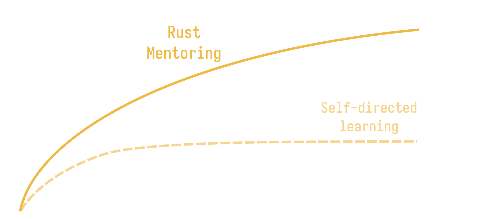
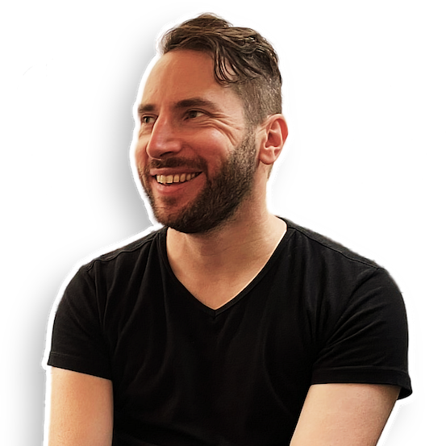
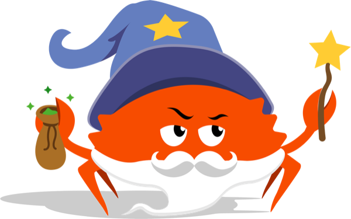
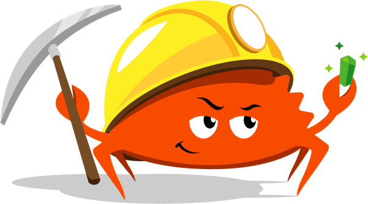

+++
title = "1-on-1 Rust Mentoring"
template = "mentorship.html"
description = "1-on-1 Rust mentoring for experienced engineers working on real projects. Build the expertise to design, review, and ship maintainable Rust systems."
aliases = ["pro", "mentorship"]
+++

<header class="pro-hero">

<h1 class="pro-hero-title">
Write, Review, 
and Ship Better Rust
</h1>

For experienced engineers moving from Python, Go, C++, or another language into serious Rust work. Bring your project or codebase and learn how to make sound design, architecture, and code-review decisions yourself.

<a href="#contact" class="pro-btn pro-btn-primary">Get Rust Mentoring</a>

Start with a short inquiry. If I think I can help, I'll invite you to a free 30-minute intro call.

<video autoplay muted loop playsinline width="1024" height="576" poster="/pro-pairing-session-poster.jpg" class="pro-hero-video" aria-label="A Rust mentoring pairing session">
    <source src="/pro-pairing-session.avif" type="video/mp4; codecs=av01" />
    <source src="/pro-pairing-session.mp4" type="video/mp4" />
</video>
</header>

<section class="pro-section">

<h2 class="pro-section-title">You Already Know How to Build Software</h2>

We'll use the experience you already have and focus on the differences in Rust. The goal is to:

<ul>
<li>Design systems you can explain and maintain.</li>
<li>Review Rust code with confidence.</li>
<li>Make sound architecture and implementation decisions.</li>
</ul>

<a href="#contact" class="pro-btn pro-btn-primary">Get Rust Mentoring</a>

</section>

<section class="pro-section">

<h2 id="mentoring-journey" class="pro-section-title">Your Mentoring Journey</h2>
<ol class="pro-timeline" role="list">
<li>
<h3><svg class="pro-timeline-icon" width="24" height="24" viewBox="0 0 24 24" fill="none" stroke="currentColor" stroke-width="1.75" stroke-linecap="round" stroke-linejoin="round" aria-hidden="true" focusable="false"><path d="M21 11a8 8 0 0 1-8 8H7l-4 3V11a8 8 0 0 1 8-8h2a8 8 0 0 1 8 8Z"/><path d="M8 9h8M8 13h5"/></svg>Tell Me About Your Goals</h3>

Share your background, what you'd like to achieve, and the time you have available in the form below. I'll review your answers and, if I think I can help, invite you to a free 30-minute intro call. We'll use that time to discuss your goals and decide whether working together makes sense.

</li>
<li>
<h3><svg class="pro-timeline-icon" width="24" height="24" viewBox="0 0 24 24" fill="none" stroke="currentColor" stroke-width="1.75" stroke-linecap="round" stroke-linejoin="round" aria-hidden="true" focusable="false"><rect x="4" y="4" width="16" height="17" rx="2"/><path d="M8 2v4M16 2v4M4 10h16m-12 5 3 3 5-5"/></svg>Make a Plan</h3>

We turn your goals into a plan around your project and experience. Together, we choose what to tackle first and set a regular session schedule that gives you time to apply what you learn. We agree on the scope and pricing before you commit.

</li>
<li>
<h3><svg class="pro-timeline-icon" width="24" height="24" viewBox="0 0 24 24" fill="none" stroke="currentColor" stroke-width="1.75" stroke-linecap="round" stroke-linejoin="round" aria-hidden="true" focusable="false"><path d="m7 7-5 5 5 5m10-10 5 5-5 5M14 4l-4 16"/></svg>Work Through Real Problems</h3>

We typically meet every two or three weeks to discuss your Rust work.
    Bring a pull request, architecture questions, or a piece of code you'd like feedback on. We'll discuss your questions and pair-program together. You leave with a clearer understanding and concrete next steps.

</li>
<li>
<h3><svg class="pro-timeline-icon" width="24" height="24" viewBox="0 0 24 24" fill="none" stroke="currentColor" stroke-width="1.75" stroke-linecap="round" stroke-linejoin="round" aria-hidden="true" focusable="false"><circle cx="12" cy="12" r="9"/><circle cx="12" cy="12" r="5"/><circle cx="12" cy="12" r="1"/></svg>Achieve Your Goals</h3>

    Whether your goal is to find a Rust job, ship an ambitious project, or become better at reviewing Rust code, you'll leave with the mental models and a process for putting your knowledge into practice. What you learn will stay with you throughout your career.

</li>
</ol>

<a href="#contact" class="pro-btn pro-btn-primary">Get Rust Mentoring</a>

</section>

<section class="pro-section">

<h2 class="pro-section-title">Hey, I'm Matthias and I Love Teaching</h2>

I've worked with Rust since 2015 and have consulted professionally since 2020. I help people get from prototype to production in Rust.

I believe the best way to build Rust expertise is by working through real problems with an experienced mentor. I ask the right questions, so you can build the right mental model.

I host the <a href="/podcast">Rust in Production Podcast</a>, where I've had more than 50 conversations with engineers and technical leaders about how Rust works in real organizations. You can also watch my <a href="https://www.youtube.com/watch?v=aZ5sfhGmEVU" target="_blank" rel="noopener">CodeCrafters teaching session</a> or read my <a href="/blog">articles on idiomatic and maintainable Rust</a>.

<section class="pro-testimonials" aria-label="Client testimonials">
<figure class="pro-testimonial">
<blockquote>I would absolutely recommend you because you readily identified a suitable solution to our problem. You were professional, easy to work with, and fun to talk to!</blockquote>
<figcaption>— Brendan Sechter, Consulting Client</figcaption>
</figure>

<figure class="pro-testimonial">
<blockquote>How much more effective it is compared to reading a book or watching a video. Glad we had it in person.</blockquote>
<figcaption>— Workshop Participant</figcaption>
</figure>

<figure class="pro-testimonial">
<blockquote>I had the pleasure of collaborating with Matthias to take my product from a prototype to a production ready solution. Thanks to Matthias's guidance, I now have a robust product built on Rust that I can trust to deliver performance and reliability.</blockquote>
<figcaption>— Somdip Datta, Senior Financial Engineer</figcaption>
</figure>

<figure class="pro-testimonial">
<blockquote>You have very good coding and Rust knowledge, and on top of it a passionate teacher. The course was fun to follow. Enjoyed it!</blockquote>
<figcaption>— Workshop Participant</figcaption>
</figure>

<figure class="pro-testimonial">
<blockquote>Your Rust expertise exceeded my expectations. In just 12 hours, you engineered solutions and taught me key concepts, bridging my zero Rust experience to project confidence. Your ability to explain clearly while coding, combined with excellent communication skills, made our time incredibly valuable.</blockquote>
<figcaption>— Torry Brelsford, Senior Software Engineer</figcaption>
</figure>
</section>

<a href="#contact" class="pro-btn pro-btn-primary">Get Rust Mentoring</a>

</section>

<section class="pro-section">

<h2 id="how-it-works" class="pro-section-title">We'll Work on What Matters to You</h2>

<article class="pro-value-item">
<h3>Recognize Good Rust</h3>

Bring a design you are unsure about, code you need to review, or a project you want to ship. We compare alternatives and make the trade-offs explicit.

You leave with a clearer understanding and concrete next steps. The goal is for you to handle the implementation.

</article>

<article class="pro-value-item">
<h3>Systems Design & Project Structure</h3>

Learn how to choose API boundaries, ownership models, traits, dependencies, and crate structure that remain understandable as the system grows.

</article>

<article class="pro-value-item">
<h3>Review Rust With Confidence</h3>

Learn to spot accidental complexity, unnecessary clones, weak type models, and overly complex abstractions.

</article>

</section>

{{ <mentoring_inquiry /> }}

<section class="pro-section">

<h2 class="pro-section-title">Frequently Asked Questions</h2>


[
  {
    "q": "Is this right for my experience level?",
    "a": "This is for experienced software engineers who want to get better at working with Rust. You might be moving from Python, Go, C++, or another language, or already using Rust and looking for feedback on your design and code-review decisions. For organization-wide support, see my <a href=\"/services/\">team consulting and training</a>."
  },
  {
    "q": "Do I need an existing Rust project?",
    "a": "No. Your own project gives us useful context, but we can also choose a realistic project or work through design and review exercises based on the kind of Rust work you want to do."
  },
  {
    "q": "What can I expect from a session?",
    "a": "We work on a concrete problem that matters to you: pairing in your repository, reviewing a pull request, or comparing architecture options. I ask questions and explain trade-offs rather than just fixing the code for you. You leave with concrete next steps and an understanding you can apply to the next problem."
  },
  {
    "q": "How often do we meet, and will it fit my schedule?",
    "a": "We typically meet every two or three weeks, with time between sessions to apply what you learn. I'm based in Germany and usually work during European business hours, but we can discuss other time zones on the intro call. If you need to reschedule a session, just let me know."
  },
  {
    "q": "How much does mentoring cost?",
    "a": "The intro call is free. We'll discuss your goals and agree on the scope, session schedule, and pricing before you commit to paid mentoring. You don't need to choose or buy a package before we talk."
  },
  {
    "q": "Can my employer pay for mentoring?",
    "a": "Yes. I provide business invoices and can describe the learning goals for your manager. If you have a professional development budget, mention it on the intro call."
  },
  {
    "q": "What if mentoring isn't a good fit?",
    "a": "The intro call gives us both a chance to find out whether working together makes sense, with no obligation to continue. If after your first paid session you don't feel it's a good fit, I'll refund you."
  },
  {
    "q": "How do I get started?",
    "a": "Fill out the short inquiry form above with your background, goals, and availability. I'll review your answers and reply by email. If I think I can help, I'll invite you to a free 30-minute intro call to discuss fit, expectations, and next steps. There's no obligation to continue."
  }
]


</section>
